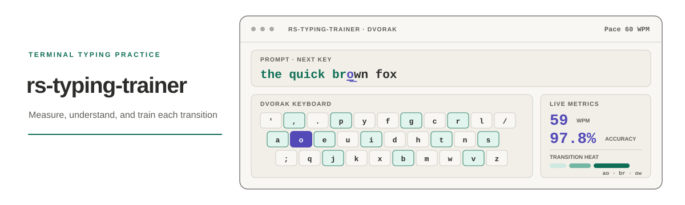

<p align="center"></p>

[English](README.md) | **日本語**

# rs-typing-trainer

指定した文字集合を練習する，ターミナル用タイピングトレーナーです．WPM・CPS・正確さ・安定度・反応時間を測り，完了したセッションを SQLite に保存して，過去の結果を見直せます．表示は英語と日本語を切り替えられます．描画には [ratatui](https://ratatui.rs) を使っています．

## インストール

```sh
cargo install --git https://github.com/akitenkrad/rs-typing-trainer
```

クローンして実行する場合:

```sh
cargo run --release
```

## クイックスタート

```sh
rs-typing-trainer
rs-typing-trainer --lang ja
rs-typing-trainer --config path/to/config.toml
rs-typing-trainer replay examples/records/dvorak-sentence-en.ttrec
```

## ドキュメント

- [遊び方](docs/gameplay.ja.md) — 操作とセッション履歴
- [訓練モードとローマ字入力](docs/modes.ja.md) — モード，キーの絞り込み，ローマ字綴り，誤入力，データファイル
- [訓練機能](docs/training.ja.md) — 適応出題，ペーサー，自動薄化，先読み，リズム，バースト，持久，立ち直り
- [キーボードの配列と表示](docs/keyboard.ja.md) — 同梱・利用者定義の配列，読み替え，Release イベント
- [出題データ](docs/data.ja.md) — 同梱データ，ライセンス，加工，再生成
- [ベンチマークと分析](docs/analysis.ja.md) — 平行版，指標，分析画面，CSV 出力
- [記録形式と指標](docs/records.ja.md) — SQLite，`.ttrec`，指標の定義
- [リプレイ](docs/replay.ja.md) — 再生オプション，サンプル記録，動画の録画
- [設定リファレンス](docs/configuration.ja.md) — すべての TOML キー，型，既定値
- [開発者向け情報](docs/development.ja.md) — ビルド，ソース構成，テスト

[rs-games](https://github.com/akitenkrad/rs-games)（Rust 製ターミナルゲームのコレクション）に収録しています．

## ライセンス

[MIT](LICENSE)
