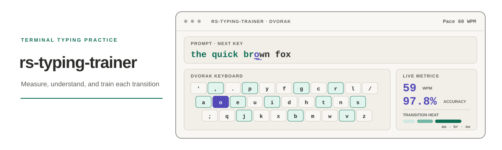

<p align="center"></p>

**English** | [日本語](README.ja.md)

# rs-typing-trainer

A terminal typing trainer for practising a chosen set of characters. It measures WPM, CPS, accuracy, consistency and reaction time, stores completed sessions in SQLite, and lets you review past results. The interface is available in English and Japanese. Built with [ratatui](https://ratatui.rs).

Absolute S-to-G grades make speed, accuracy and typing-technique components visible. A personalized Coach connects those grades and recorded diagnoses to concrete practice, then reports whether adaptive prescriptions helped.

## Install

```sh
cargo install --git https://github.com/akitenkrad/rs-typing-trainer
```

Or from a clone:

```sh
cargo run --release
```

## Quick start

```sh
rs-typing-trainer
rs-typing-trainer --lang ja
rs-typing-trainer --config path/to/config.toml
rs-typing-trainer graphics
rs-typing-trainer replay examples/records/dvorak-sentence-en.ttrec
```

## Documentation

- [Playing rs-typing-trainer](docs/gameplay.md) — controls and session history
- [Training modes and romaji input](docs/modes.md) — modes, key filters, romaji spellings, error handling and data files
- [Training tools](docs/training.md) — adaptive practice, pacing, fading, look-ahead, rhythm, burst, endurance and recovery
- [Keyboard layouts and display](docs/keyboard.md) — bundled and custom layouts, remapping and release events
- [Prompt data](docs/data.md) — bundled datasets, licenses, processing and regeneration
- [Benchmarks and analysis](docs/analysis.md) — parallel forms, metrics, analysis screen and CSV export
- [Record format and metrics](docs/records.md) — SQLite, `.ttrec`, and metric definitions
- [Replay](docs/replay.md) — playback options, sample records and video recording
- [Configuration reference](docs/configuration.md) — every TOML key, type and default
- [Terminal graphics](docs/graphics.md) — detection, diagnostics and terminal support
- [Development](docs/development.md) — building, source layout and tests

Part of [rs-games](https://github.com/akitenkrad/rs-games), a collection of terminal games written in Rust.

## License

[MIT](LICENSE)
